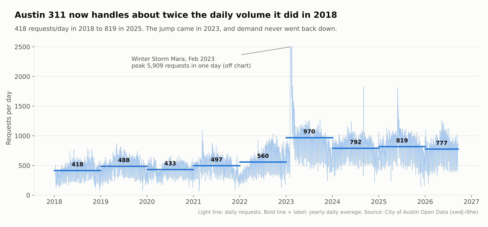
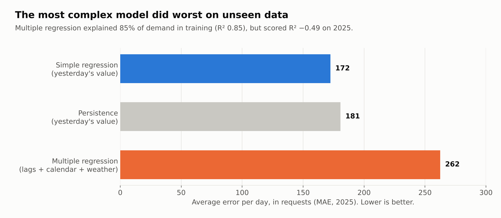
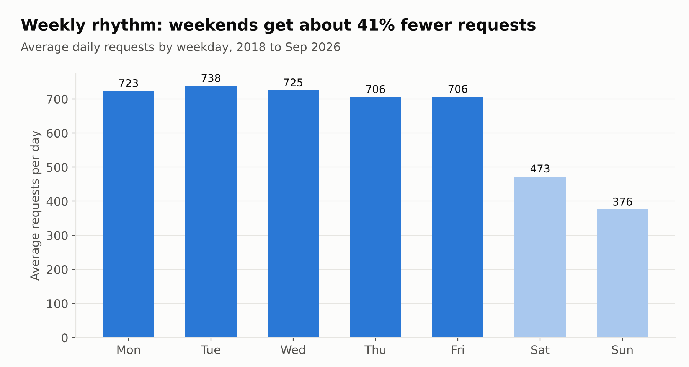

# Austin 311 Service Demand: What 8 Years of Requests Say About Planning

**I tried to forecast Austin's daily 311 volume using 2 million service requests and NOAA weather data. The models did not hold up on unseen data, and working out *why* revealed how 311 demand has changed since 2018.**



## Key findings at a glance

| | Finding | Why it matters for planning |
|---|---|---|
| 1 | **Daily volume roughly doubled**, from 418 requests/day in 2018 to 819 in 2025. | Capacity planned on pre-2023 volumes would be undersized by a third or more. |
| 2 | **The jump came in 2023 and stayed.** Winter Storm Mara (Feb 2023) produced the biggest spike in the data (5,909 requests on Feb 6), but volume stayed at 780–820/day in 2024–2026. | This was a lasting step up, not a one-off storm spike. |
| 3 | **There's a strong weekly rhythm.** Weekends average 424 requests/day vs. 720 on weekdays (about 41% lower). | Day of the week is a key planning signal. |
| 4 | **Weather barely matters day to day.** Temperature explains about 3% of variation; rainfall and wind explain close to nothing. | Except for extreme events like ice storms, weather is not a useful everyday planning input. |
| 5 | **The most complex model did worst on unseen data.** Multiple regression explained 85% of training demand but scored R² −0.49 on 2025. | Strong training performance means little without a chronological holdout. |
| 6 | **Demand patterns shifted over time.** The link between yesterday's and today's volume dropped from a correlation of 0.81 in training to 0.46 in 2025. | Models trained on the "old normal" break quietly when demand changes. |



## The story

**The question.** Can past demand, the calendar, and the weather predict how many 311 requests Austin will get tomorrow? Daily volume drives call-center staffing and crew dispatch, so a reliable one-day-ahead number has operational value.

**What I built.** I turned 2,020,304 individual service requests (Jan 2018 – Sep 2026) into a clean daily time series and joined it to NOAA daily weather from Camp Mabry. I engineered lag, rolling, and calendar features, and compared three approaches with a strict chronological split: **train on 2018–2024, test on 2025, final holdout Jan–Sep 2026**. Nothing from the future leaks into training.

**What happened.**

| Model | 2025 MAE | 2025 RMSE | 2025 R² |
|---|---:|---:|---:|
| Persistence baseline (yesterday's value) | 180.71 | 245.56 | −0.083 |
| **Simple linear regression** (yesterday's value) | **172.37** | **229.28** | **0.056** |
| Multiple linear regression (lags + calendar + weather) | 262.54 | 288.07 | −0.491 |

Simple linear regression was the best of the three, so I took it to the 2026 holdout: **MAE 167.59, RMSE 233.20, R² −0.095**. The average error stayed similar, but the model did no better than predicting the average every day.

**Why it happened.** Two things changed under the models:

1. **The level shifted.** Average demand went from 560/day in 2022 to 970 in 2023, and has stayed around 800 since. The 2025 test period averaged 819/day vs. 595 in training, so the multiple regression under-predicted by about 259 requests per day.
2. **The relationship shifted.** The correlation between yesterday's and today's volume ranged from 0.35 to 0.83 depending on the year. A model that leans on "yesterday predicts today" breaks when that link weakens.

This pattern is consistent with **concept drift**: what the model learned stopped being true. It wasn't formally tested here.

**The takeaway.** A clear, honest evaluation that says *don't deploy this yet* is a useful result. For 311 planning:

- The evaluated models are **not recommended for operational forecasting** in their current form.
- Re-check assumptions after major events and policy changes, since demand levels can step up and stay there.
- Any future model must show consistent performance across several out-of-sample periods before operational use.



## Data Sources

**1. Austin 311 Public Data**

- Source: City of Austin Open Data Portal
- Dataset: [Austin 311 Public Data](https://data.austintexas.gov/City-Government/Austin-311-Public-Data/xwdj-i9he)
- Dataset ID: `xwdj-i9he`
- Original dataset: More than 2 million service request records.
- Used to calculate daily service request volumes.

**2. Historical Weather Data**

- Source: NOAA National Centers for Environmental Information
- Dataset: GHCN-Daily
- Weather station: Austin Camp Mabry, Texas (`USW00013958`)
- Used weather variables: average, maximum and minimum temperature, precipitation, and average wind speed.

## Tools & Technologies

- **Programming:** Python
- **Data Analysis:** Pandas, NumPy
- **Visualization:** Matplotlib
- **Statistical Modeling:** Statsmodels
- **Machine Learning:** Scikit-learn
- **Environment:** Jupyter Notebook, Anaconda
- **Data Sources:** City of Austin Open Data Portal, NOAA

## Project Workflow

### 1. Data Collection and Preparation

- Retrieved more than 2 million Austin 311 service records.
- Parsed service request timestamps and aggregated records into daily request counts.
- Retrieved historical daily weather observations from NOAA.
- Cleaned and prepared weather variables, handled missing observations, and merged demand and weather data by date.
- Created calendar and historical demand features for analysis and prediction.

### 2. Exploratory Data Analysis

Investigated daily, weekly, and monthly demand patterns and explored relationships between service request volumes and weather conditions.

Key observations:

- Average weekday demand was approximately 720 requests per day, compared with approximately 424 on weekends.
- Weekday demand was approximately 41% higher than weekend demand.
- Daily request volumes varied substantially across years.
- Temperature showed a modest positive correlation with daily demand, while precipitation and wind had very weak linear correlations.

### 3. Feature Engineering

Created features to capture historical demand patterns and calendar effects:

- Previous day's request volume (`lag_1`)
- Request volume seven days earlier (`lag_7`)
- Seven-day rolling average of historical demand (`rolling_7`)
- Day of week, month, and year
- Daily temperature, precipitation, and wind speed

Lag and rolling features were shifted to ensure that only information available before the prediction date was used.

### 4. Predictive Modeling

Compared three approaches:

1. **Persistence Baseline:** Uses the previous day's actual request volume as the prediction.
2. **Simple Linear Regression:** Uses previous day's request volume as the predictor.
3. **Multiple Linear Regression:** Incorporates historical demand, calendar, and weather features.

Models were trained on data from 2018–2024 and evaluated on the unseen 2025 test period.

The selected candidate was subsequently evaluated on a separate 2026 holdout period.

### 5. Model Evaluation

Used the following metrics:

- **MAE (Mean Absolute Error):** Average absolute difference between actual and predicted request counts.
- **RMSE (Root Mean Squared Error):** Measures prediction error while penalizing larger errors more heavily.
- **R² (Coefficient of Determination):** Measures how much variation in the target is explained by the model relative to a mean-based prediction.
- Chronological split: train 2018–2024 (2,550 days), test 2025 (365 days), final holdout Jan 1 – Sep 17, 2026 (260 days).
- Diagnostics: VIF for multicollinearity (`rolling_7` VIF 12.5), a reduced model without `rolling_7`, and year-by-year level and lag-correlation analysis to explain the out-of-sample failure.

## Results

### 2025 Model Comparison

| Model | MAE | RMSE | R² |
|---|---:|---:|---:|
| Persistence Baseline | 180.71 | 245.56 | -0.083 |
| Simple Linear Regression | **172.37** | **229.28** | **0.056** |
| Multiple Linear Regression | 262.54 | 288.07 | -0.491 |

Simple Linear Regression was selected as the best-performing candidate based on the 2025 comparison.

### 2026 Final Holdout Evaluation

The selected Simple Linear Regression model was evaluated on January 1 through September 17, 2026.

| Metric | Result |
|---|---:|
| MAE | 167.59 |
| RMSE | 233.20 |
| R² | -0.095 |

Although the average absolute error was similar to the 2025 test period, the negative R² indicates that the model did not outperform a simple prediction based on average demand for the 2026 holdout period.

## Limitations and next steps

- Observational analysis; no causal claims about weather or calendar effects.
- One-day-ahead forecasting only, using the previous day's actual volume.
- The 2026 holdout covers only Jan 1 – Sep 17, 2026.
- Not included: request categories, open backlog, holidays, major events, and staffing.
- Next steps: add those operational inputs, try rolling-window retraining to adapt to changing demand, and monitor performance across future periods.

## Repository structure

```text
Austin_311_Service_Request_Demand_Project/
├── data/
│   ├── austin_311_daily.csv     # daily request counts (from the 2M-row raw file)
│   ├── austin_weather.csv       # cleaned NOAA weather
│   └── austin_311_model.csv     # merged modeling dataset with features
├── images/                      # charts used in this README
├── notebooks/
│   └── Austin_311_Demand_Analysis.ipynb
├── scripts/
│   └── make_figures.py          # regenerates the README charts
├── README.md
└── requirements.txt
```

The raw 311 export (`austin_311.csv`, ~2M rows) is too large for GitHub. Download it from the portal link above into `data/` to rerun Part 1 of the notebook. Everything after Part 1 runs from the CSVs already in `data/`.

## How to run

```bash
git clone https://github.com/TechWithTanvi/Austin_311_Service_Request_Demand_Project.git
cd Austin_311_Service_Request_Demand_Project
pip install -r requirements.txt
python scripts/make_figures.py      # regenerate the charts
jupyter notebook notebooks/Austin_311_Demand_Analysis.ipynb
```

**Tools:** Python, pandas, NumPy, statsmodels, scikit-learn, Matplotlib, Jupyter.

## Disclaimer

This is an independent portfolio project using publicly available City of Austin and NOAA data. It is not an official City of Austin analysis or a deployed forecasting system.
## Disclaimer

This is an independent portfolio project using publicly available City of Austin and NOAA datasets. It is not an official City of Austin project, commissioned analysis, or deployed forecasting system.
